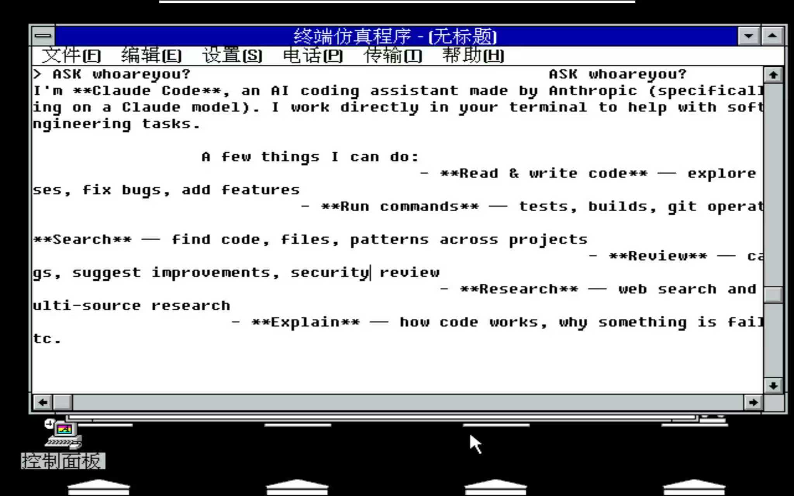

# RetroAgent for Windows 3.2

在中文 Windows 3.2 的终端里输入问题，由宿主机上的 Claude CLI 生成回复，再通过虚拟串口显示回来。

📖 **[项目全文](articles/win3.2-claude.md)** · 📦 **[GitHub](https://github.com/ameriadam12/retroagent-win3.2)**

适合复古计算与串口桥接实验。Windows 3.2 端使用系统自带 `Terminal.exe`；模型调用发生在宿主机，需要可用的 `claude` 命令及对应账户配置。



## 使用示例

启动后，在 Windows 3.2 的 Terminal 中输入：

```text
ASK 用一句中文介绍你自己。
```

Bridge 先回显问题，再输出完整回复；收到模型的思考事件时显示 `*Thinking`。回复采用 GBK 编码和换行处理，**不会逐 token 流式显示**。同一串口连接内的后续问题会续接 Claude session。

先检查串口是否连通，也可以输入：

```text
PING
```

Bridge 的固定回复为 `PONG RetroAgent/1`。

## 安装与启动

需要支持 Unix socket 的宿主环境，以及 Python 3、`qemu-system-x86_64`、VNC 客户端和可运行的 Claude CLI。启动脚本使用 Bash。

```sh
git clone https://github.com/ameriadam12/retroagent-win3.2.git
cd retroagent-win3.2
```

仓库已包含 `vm/disks/win32.qcow2`。默认启动使用这份镜像，**无需先下载 DOS 或 Windows 安装介质**。

Bridge 固定使用项目内的 `claude-home/` 作为 Claude 配置目录。先在同一目录下确认 CLI 可用：

```sh
CLAUDE_CONFIG_DIR="$PWD/claude-home" claude
```

完成账户配置并退出 CLI 后，启动 Bridge 与 QEMU：

```sh
./start.sh
```

在另一个终端连接 VNC：

```sh
vncviewer 127.0.0.1:5900
```

进入 Windows 3.2 后：

1. 若停在 DOS 提示符，输入 `win`。
2. 通过 **File → Run** 打开 `C:\WINDOWS\TERMINAL.EXE`。
3. **Settings → Communications**：COM1、9600、8-N-1。
4. **Settings → Terminal Preferences**：勾选 **Local Echo** 和 **Line Wrap**。
5. 输入 `PING` 或 `ASK <问题>`，按回车。

在运行 `start.sh` 的终端按 Ctrl+C 停止。VNC 绑定 `127.0.0.1:5900`；Bridge 与 QEMU 的日志分别位于 `vm/run/bridge.log` 和 `vm/run/qemu.log`。

## 连接方式

Windows Terminal 将一行命令写入 COM1；QEMU 把串口连接到 Unix socket，Python Bridge 调用宿主机的 Claude CLI，再把回复写回串口。Windows 3.2 本身不运行 Claude Code，也不需要自行访问模型服务。

| 组件 | 实现 |
| --- | --- |
| 串口协议、GBK 编解码、Claude session | [bridge/retrobridge.py](bridge/retrobridge.py) |
| Bridge、QEMU 与 VNC 启动 | [start.sh](start.sh) |
| 项目记录与演示背景 | [articles/win3.2-claude.md](articles/win3.2-claude.md) |

## 已知限制

- 当前推荐客户端是系统自带 Terminal。项目记录中，`client-win16/client.exe` 在 Windows 3.2 加载崩溃，保留源码供排查。
- GBK 无法表示的字符会被替换；回复中的 Markdown 会作为纯文本显示。
- `*Thinking` 取决于 CLI 是否发出相应事件，不能保证每轮出现。
- 现有 `bridge/loopback_client.py` 等待 `__END__` 结束标记，但 Bridge 当前没有发送该标记；它不能作为默认可完成的回环验证。
- 本仓库没有根 LICENSE 文件；Windows／DOS 镜像、安装介质和其他第三方工具的许可需要分别确认。

## 开发与排查

重新编译 Win16 客户端、安装介质来源、QMP 读屏与工具链问题，见 [CONTRIBUTING.md](CONTRIBUTING.md)。完整项目记录保留在 [文章](articles/win3.2-claude.md) 中。
